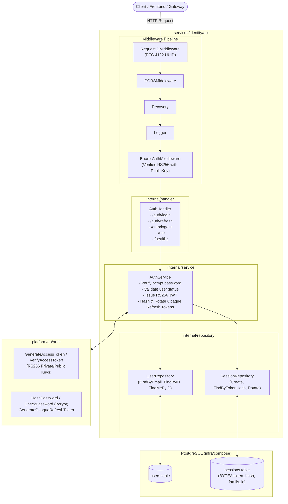
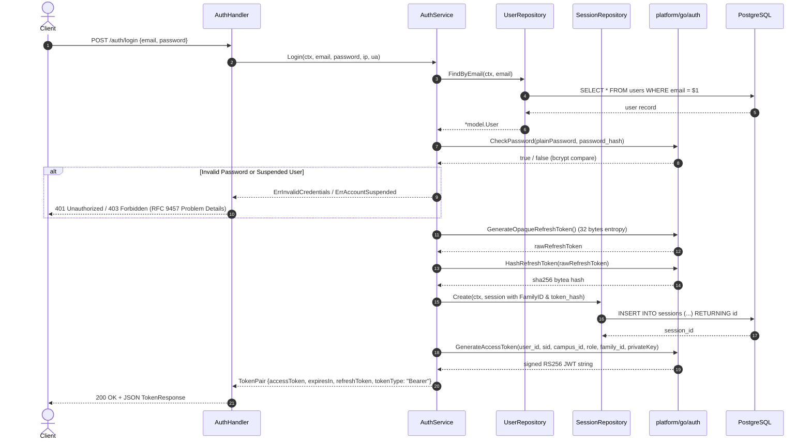
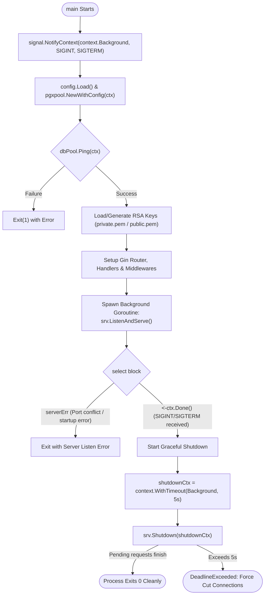

# Identity Service Architecture & Workflows

This document contains visual architectural specifications and sequence diagrams for the Campus++ Identity Service.

---

## 1. Overall System Architecture & Request Pipeline

---

## 2. Authentication Flow (`POST /auth/login`)

---

## 3. Server Lifecycle & Context Supervision (`cmd/server/main.go`)

