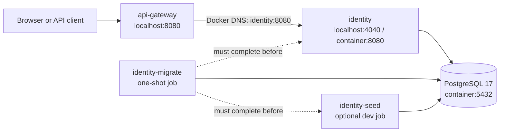
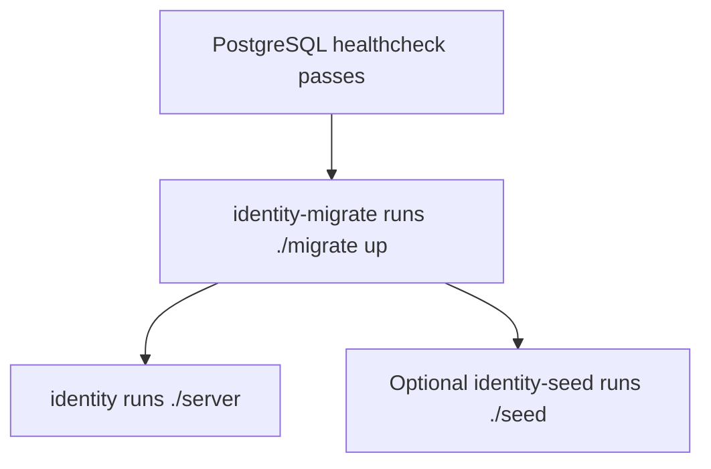
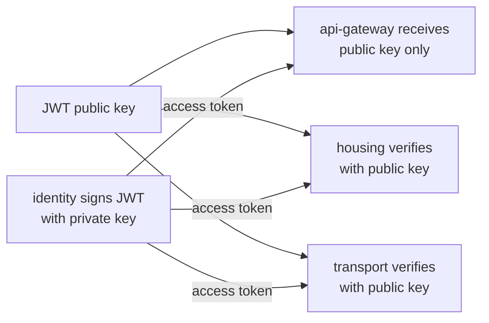
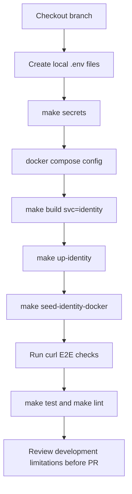

# Campus++ — Development Container Guide

This document describes the current development state of the Campus++ platform and the container work delivered by `feat/SCRUM-19-identity-scaffold`.

The branch establishes a reproducible local environment for the API Gateway, Identity service, PostgreSQL, Identity migrations, and development seed data. It is intended for local development and integration testing—not production deployment.

## Scope

This branch currently provides:

- Workspace-aware Docker builds for the Go API Gateway and Identity service.
- A minimal non-root Alpine runtime image for each Go service.
- PostgreSQL 17 through Docker Compose.
- An explicit Identity migration job.
- An optional development-only Identity seed job.
- Local RSA key generation for JWT signing and verification.
- Docker Compose service discovery on the `app_net` network.
- Identity session-token rotation fixes for the current authentication slice.

Housing and Transport are represented in the repository structure and configuration, but their application containers are not yet part of the current Compose deployment.

## Architecture



### Compose services

| Service | Profile | Role | Local access |
|---|---|---|---|
| `postgres` | `infra`, `gateway`, `identity`, `all` | Stores the Identity database | `localhost:5432` |
| `identity-migrate` | `identity`, `seed`, `all` | Applies SQL migrations and exits | Internal only |
| `identity` | `identity`, `all` | Authentication and session API | `localhost:4040` |
| `identity-seed` | `seed` | Inserts predictable development users and exits | Internal only |
| `api-gateway` | `gateway`, `identity`, `all` | Reverse proxy for API routes | `localhost:8080` |

The Identity startup dependency chain is:



`identity-seed` is intentionally separate from the server. Restarting the Identity API does not automatically rewrite development users.

## Requirements

### Required tools

- Docker Engine with Docker Compose v2 (`docker compose`, not legacy `docker-compose`).
- Go `1.25.11`, matching the container builder and module declarations.
- GNU Make.
- OpenSSL, used by `make secrets` to generate local RSA keys.
- Node.js and pnpm for frontend and TypeScript workspace tests.
- `golangci-lint` for the Go quality gate.
- `curl` for the manual E2E examples.

Docker must be running before using the Compose targets.

### Required local files

The following files are local configuration and must not be committed:

```text
infra/compose/.env
services/identity/api/.env.docker
api-gateway/.env
infra/compose/secrets/jwt_private_key.pem
infra/compose/secrets/jwt_public_key.pem
```

Example templates are available at:

```text
infra/compose/.env.example
services/identity/api/.env.docker.example
api-gateway/.env.example
```

The Docker Compose files expect the actual `.env` files to exist. Use development-only values for local work.

## Secrets and JWT key flow

### Generate development keys

Run:

```bash
make secrets
```

This creates an RSA key pair:

```text
infra/compose/secrets/jwt_private_key.pem
infra/compose/secrets/jwt_public_key.pem
```

The command is idempotent and does not overwrite existing keys. Removing the keys invalidates tokens signed by the old private key:

```bash
make secrets-clean
```

### Current secret mounting

```mermaid
flowchart LR
    Private[infra/compose/secrets/jwt_private_key.pem]
    Public[infra/compose/secrets/jwt_public_key.pem]
    Compose[Docker Compose secret definitions]
    IdentityPrivate[/run/secrets/jwt_private_key]
    IdentityPublic[/run/secrets/jwt_public_key]
    Sign[Identity signs access JWTs]
    Verify[Identity verifies JWTs]

    Private --> Compose --> IdentityPrivate --> Sign
    Public --> Compose --> IdentityPublic --> Verify
```

The Identity container receives these environment variables:

```text
JWT_PRIVATE_KEY_PATH=/run/secrets/jwt_private_key
JWT_PUBLIC_KEY_PATH=/run/secrets/jwt_public_key
```

The private key must remain restricted to Identity. Other services must never receive the private key.

### How future services should consume secrets

Downstream services that verify Identity access tokens should receive only the public key:



For each future verifier service:

1. Define the public key as a Docker secret.
2. Mount it at `/run/secrets/jwt_public_key`.
3. Set `JWT_PUBLIC_KEY_PATH=/run/secrets/jwt_public_key`.
4. Do not mount or copy `jwt_private_key.pem` into that service.
5. Keep the service on `app_net` if it needs to call Identity or another internal service.

The current Compose file mounts both signing and verification keys into `identity`, while `api-gateway` receives only the public key. The Gateway is configured with `JWT_PUBLIC_KEY_PATH=/run/secrets/jwt_public_key`, but complete JWT verification middleware is still follow-up work.

## Service discovery

Containers communicate using Compose service names, not `localhost`:

| Caller | Target | Address inside Compose |
|---|---|---|
| `identity` | PostgreSQL | `postgres:5432` |
| `identity-migrate` | PostgreSQL | `postgres:5432` |
| `identity-seed` | PostgreSQL | `postgres:5432` |
| `api-gateway` | Identity | `http://identity:8080/auth` |
| Future services | Identity | `http://identity:8080` |

`localhost` refers to the current container, so it must not be used for container-to-container calls.

The host-facing development endpoints are:

| Endpoint | Purpose |
|---|---|
| `http://localhost:8080` | API Gateway |
| `http://localhost:4040` | Identity directly |
| `http://localhost:5432` | PostgreSQL, for local database tooling |

The Gateway currently routes Identity authentication requests through:

```text
/api/v1/auth/*  →  http://identity:8080/auth/*
```

## First-time setup

### 1. Prepare environment files

Copy the templates if the local files do not exist:

```bash
cp infra/compose/.env.example infra/compose/.env
cp services/identity/api/.env.docker.example services/identity/api/.env.docker
cp api-gateway/.env.example api-gateway/.env
```

Replace placeholder values in the copied files with valid local development values. In particular, PostgreSQL values in `infra/compose/.env` must match the values used by Compose.

### 2. Generate JWT keys

```bash
make secrets
```

### 3. Validate Compose

```bash
docker compose \
  -f infra/compose/docker-compose.yml \
  --profile identity \
  --profile seed \
  config
```

The command should print the resolved configuration without errors.

## Running the development environment

### Start PostgreSQL, migrations, Gateway, and Identity

```bash
make up-identity
```

This uses the `identity` profile. Because the Gateway also belongs to that profile, the Gateway is started as part of this development stack.

Check service status:

```bash
docker compose \
  -f infra/compose/docker-compose.yml \
  --profile identity ps
```

View logs:

```bash
make logs svc=identity s=identity
make logs svc=identity s=identity-migrate
make logs svc=identity s=api-gateway
```

### Run the development seed

The seed is not run automatically by `make up-identity`.

Run it explicitly:

```bash
make seed-identity-docker
```

The seed creates or updates these development accounts:

| Email | Role |
|---|---|
| `sara.benali@campus.ma` | `student` |
| `worker@campus.ma` | `worker` |
| `admin@campus.ma` | `admin` |

The seed is idempotent for normal repeated local runs. Its passwords are development fixtures and must not be used as production credentials.

### Stop the stack

```bash
make down svc=identity
```

To remove the development database volume as well:

```bash
docker compose \
  -f infra/compose/docker-compose.yml \
  --profile identity down -v
```

The `-v` option deletes local database state. Use it only when a clean database is required.

## End-to-end development flow

### 1. Start and seed

```bash
make secrets
make up-identity
make seed-identity-docker
```

### 2. Check Identity health

```bash
curl -i http://localhost:4040/healthz
```

Expected result: HTTP `200`.

### 3. Log in directly against Identity

```bash
curl -i -X POST http://localhost:4040/auth/login \
  -H 'Content-Type: application/json' \
  -d '{
    "email": "sara.benali@campus.ma",
    "password": "<DEVELOPMENT_PASSWORD>"
  }'
```

Save the returned `accessToken` and `refreshToken` for the next checks. Do not log or commit real refresh tokens.

### 4. Log in through the Gateway

```bash
curl -i -X POST http://localhost:8080/api/v1/auth/login \
  -H 'Content-Type: application/json' \
  -d '{
    "email": "sara.benali@campus.ma",
    "password": "<DEVELOPMENT_PASSWORD>"
  }'
```

### 5. Refresh the session

Replace `<REFRESH_TOKEN>` with the token returned by login:

```bash
curl -i -X POST http://localhost:4040/auth/refresh \
  -H 'Content-Type: application/json' \
  -d '{"refreshToken":"<REFRESH_TOKEN>"}'
```

The response should contain a new access token and a new refresh token. The previous refresh token should no longer be usable.

### 6. Read the current user

Replace `<ACCESS_TOKEN>` with the access token returned by login:

```bash
curl -i http://localhost:4040/me \
  -H 'Authorization: Bearer <ACCESS_TOKEN>'
```

### 7. Log out

```bash
curl -i -X POST http://localhost:4040/auth/logout \
  -H 'Content-Type: application/json' \
  -d '{"refreshToken":"<REFRESH_TOKEN>"}'
```

Logout is expected to be idempotent and return HTTP `204` for an already-revoked development token.

## Tests and quality gates

### Go and workspace tests

Run the repository test target:

```bash
make test
```

The target runs:

- API Gateway Go tests.
- Shared platform Go tests.
- Identity Go tests.
- Recursive pnpm workspace tests.

Run individual suites when narrowing down a failure:

```bash
make test-gateway
make test-platform
make test-service-identity
```

### Linting

```bash
make lint
```

This requires `golangci-lint` and pnpm lint dependencies to be installed.

### Generated contracts

If the Identity OpenAPI contract changes:

```bash
make gen
make check-gen
```

The contract must be updated before generated client/server code is regenerated.

### Container checks

```bash
docker compose \
  -f infra/compose/docker-compose.yml \
  --profile identity \
  --profile seed \
  config

docker compose \
  -f infra/compose/docker-compose.yml \
  --profile identity \
  build api-gateway identity identity-migrate
```

Confirm the Identity image contains:

```text
/app/server
/app/migrate
/app/seed
/app/migrations/
```

### Database and seed checks

The migration job must exit with status `0` before Identity starts. The seed job must also exit with status `0` when explicitly requested.

Repeat the seed command to verify local idempotency:

```bash
make seed-identity-docker
make seed-identity-docker
```

## Development limitations and security notes

- This Compose setup is for development and integration testing only.
- Development seed passwords are predictable and must not be promoted to staging or production.
- The seed command should not be enabled in production profiles.
- JWT private keys must remain available only to Identity.
- Other services should receive only the JWT public key when token verification is implemented.
- The local PostgreSQL password in Compose is not production-safe.
- The current Gateway does not yet provide complete JWT verification middleware.
- Housing and Transport containers are not yet implemented in the current Compose file.
- The migration job is a one-shot container and should be treated as a deployment step, not a long-running service.
- Removing the local JWT key pair invalidates all tokens issued with the previous private key.

## Troubleshooting

### Compose cannot find an environment file

Create the required local files from the example templates and replace placeholders:

```bash
cp infra/compose/.env.example infra/compose/.env
cp services/identity/api/.env.docker.example services/identity/api/.env.docker
cp api-gateway/.env.example api-gateway/.env
```

### Identity starts before the schema exists

Inspect the migration job:

```bash
docker compose \
  -f infra/compose/docker-compose.yml \
  --profile identity logs identity-migrate
```

Identity depends on successful completion of `identity-migrate`. A non-zero migration exit status prevents normal startup.

### Seed cannot connect to PostgreSQL

Confirm that PostgreSQL is healthy and invoke both required profiles:

```bash
docker compose \
  -f infra/compose/docker-compose.yml \
  --profile identity \
  --profile seed \
  run --rm identity-seed
```

### JWT signing or verification fails

Check that both key files exist and that the paths match the Compose mounts:

```bash
ls -l infra/compose/secrets/jwt_private_key.pem
ls -l infra/compose/secrets/jwt_public_key.pem
```

Regenerate only when intentionally invalidating existing local tokens:

```bash
make secrets-clean
make secrets
```

### Clean development reset

```bash
docker compose \
  -f infra/compose/docker-compose.yml \
  --profile identity down -v
make secrets
make up-identity
make seed-identity-docker
```

## Development workflow summary


